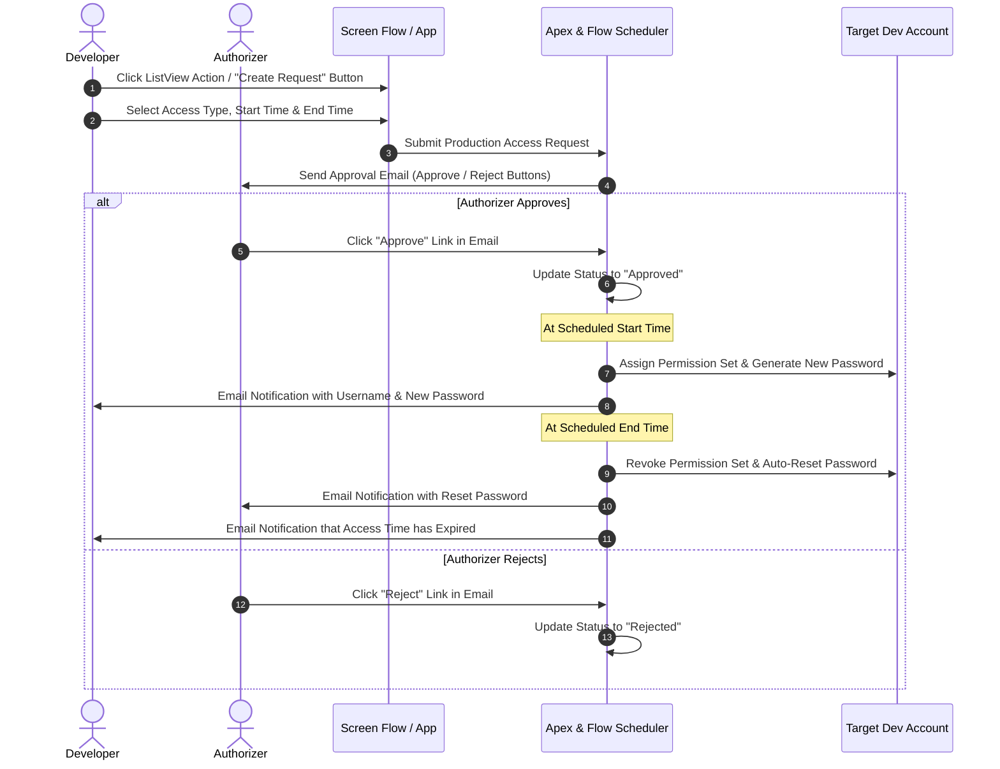

# Production Access Request & Security Management

An automated, time-bound Salesforce production access management solution allowing developers to request temporary access, with automated email approvals, automated password generation, dynamic permission set assignment upon start time, and automatic access revocation/password reset upon expiration.

---

## 📦 Package Installation

Install the package into your Salesforce organization using the links below (Package Version `2.0.0-2`, Package ID `04tgL000000ZMthQAG`):

- **Production / Developer Org Installation Link**:  
  [Install Package in Production](https://login.salesforce.com/packaging/installPackage.apexp?p0=04tgL000000ZMthQAG)

- **Sandbox Installation Link**:  
  [Install Package in Sandbox](https://test.salesforce.com/packaging/installPackage.apexp?p0=04tgL000000ZMthQAG)

> [!NOTE]  
> **Package Version Note**: Always prefer and check for the latest package version ID from the [`sfdx-project.json`](file:///c:/Users/Hp/Desktop/sfdc%20Project/AdminSecurityCheck/sfdx-project.json) file under `packageAliases`.

---

## 🛠️ After-Installation Configuration Guide

Follow these post-installation setup steps to configure the application in your org:

### 1. Create Permission Sets / Permission Set Groups
* Create the required **Permission Sets** Salesforce setup that represent the specific levels of access/permissions needed by developers during elevated production access windows.

### 2. Configure Production Access Types (Custom Metadata)
* Navigate to **Setup > Custom Metadata Types > Production Access Type**.
* Create new records for each access type that developers can request:
  * **Label**: Descriptive name (e.g., `Developer Access`).
  * **Permission Set API Name**: Exact API Name of the Permission Set / Group created in Step 1.
  * **Active**: Set to `true` (Checkbox selected).
  > **Note:** Only active `Production_Access_Type__mdt` records will be populated in the drop-down selection of the Screen Flow when developers submit access requests.

### 3. Configure Main Production Access Configuration (Custom Metadata)
* Navigate to **Setup > Custom Metadata Types > Production Access Config**.
* Create a record (`Production_Access_Config__mdt`):
  * **Project Name**: Specify the project name.
  * **Authorizers Email IDs**: Comma-separated list of authorizer email addresses (e.g., `approver1@example.com, approver2@example.com`).
  * **Production Username**: The username of the target development/service account to which permissions will be assigned temporarily.
  * **Password**: Leave this field **blank** / empty (it is dynamically generated and set by the record-triggered flow upon activation).
  * **Active**: Set to `true`.

### 4. Configure Salesforce Site & Custom Label Base URL
* Configure a Public Salesforce Site named **`production access`** (or your designated public site).
* Ensure the REST Resource `ProductionAccessApprovalRestResource` is accessible by the Site Guest User.
* Update the Custom Label `Production_Access_Site_Base_URL` in [CustomLabels.labels-meta.xml](file:///c:/Users/Hp/Desktop/sfdc%20Project/AdminSecurityCheck/force-app/main/default/labels/CustomLabels.labels-meta.xml):
  * **Value**: Set to the Base URL of your configured Salesforce Site (e.g., `https://<site-subdomain>.my.salesforce-sites.com/productionaccess`).

### 5. Provision Developer User Accounts
* Create developer user accounts using the **Identity User** license type paired with the **Production Access Profile**.
* Once developers are provisioned with these accounts, they can log in and access the Production Access App and submit requests.

---

## 🔄 End-to-End User Workflow

Here is how the end-to-end access request lifecycle functions:

### Step-by-Step Workflow Execution:

1. **Submitting a Request**:
   * Provisioned Identity User developers log in and click the List View Action button to launch the **Create Production Access Request** Screen Flow.
   * Developer fills in the request details: selects an **Access Type** (from active Custom Metadata), sets **Start Time**, and **End Time**.

2. **Email Approval Process**:
   * Upon request submission, an automated approval email containing direct **Approve** and **Reject** action links is dispatched to the designated authorizers.

3. **Access Activation at Start Time**:
   * Once approved, at the exact **Start Time** specified by the developer:
     * The designated **Permission Set** is automatically assigned to the target developer/development user account.
     * A temporary **New Password** is generated.
     * An email notification containing the username and temporary credentials is sent to the developer.

4. **Access Expiration at End Time**:
   * At the designated **End Time**:
     * The assigned **Permission Set is automatically revoked**.
     * The target account's **password is automatically reset**.
     * The authorizer receives an email notification with the reset details.
     * The developer receives an email notification informing them that their access window has ended.
